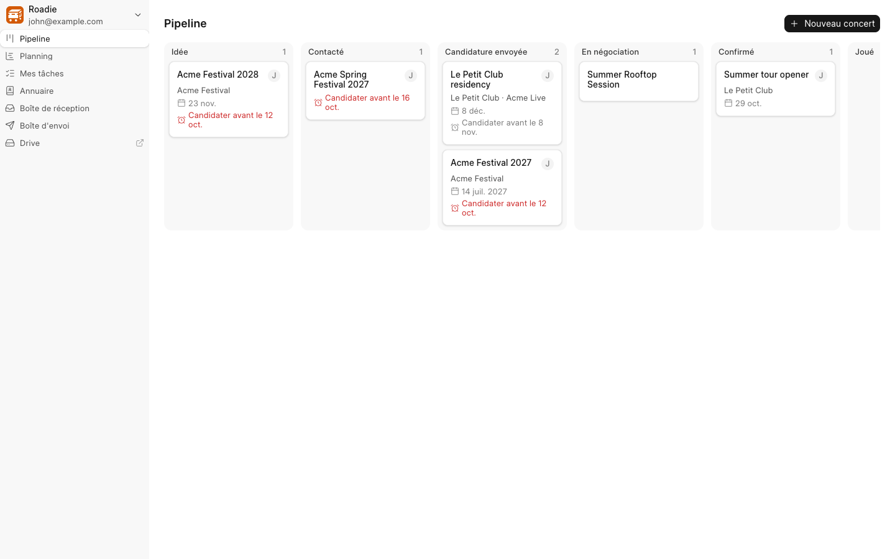
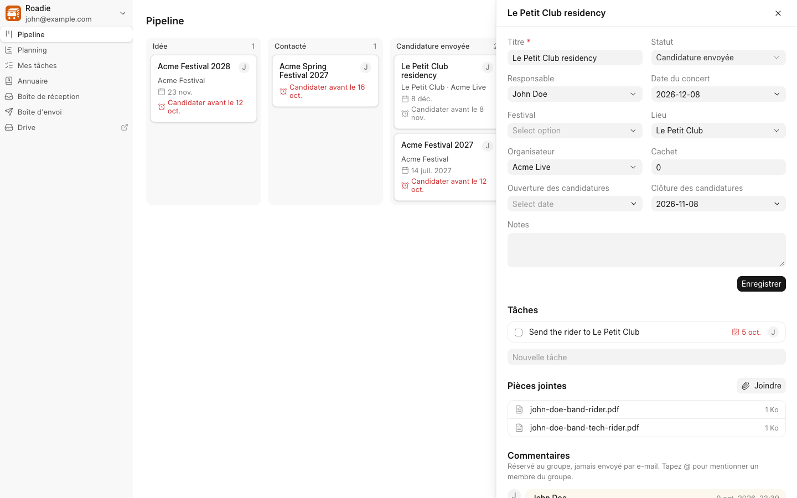
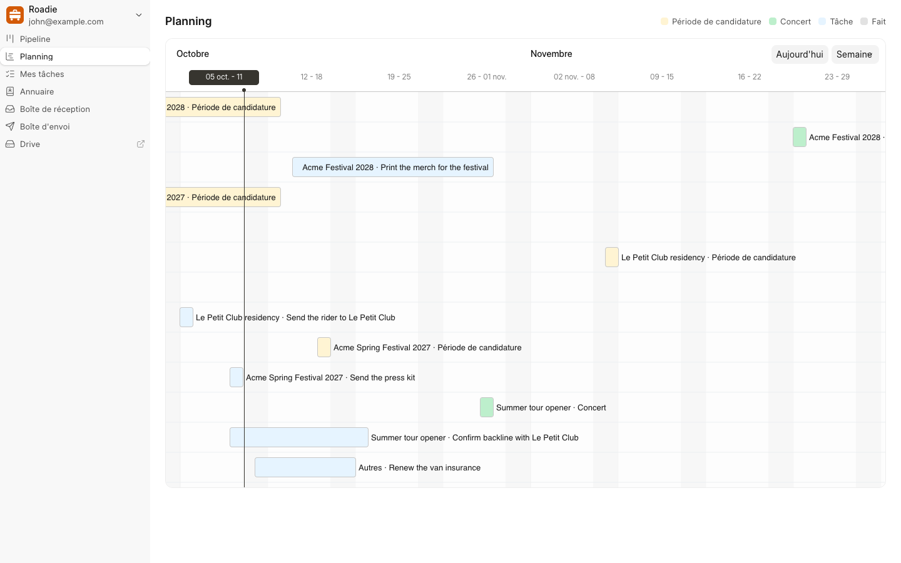
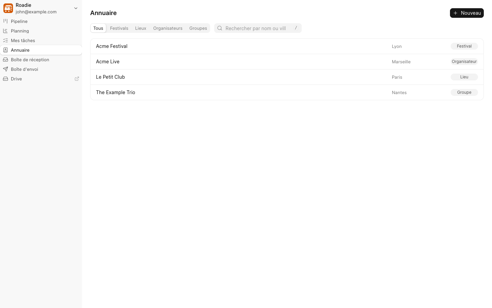
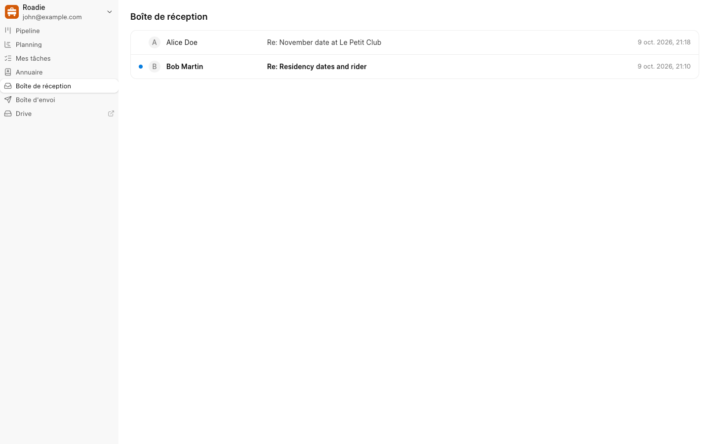
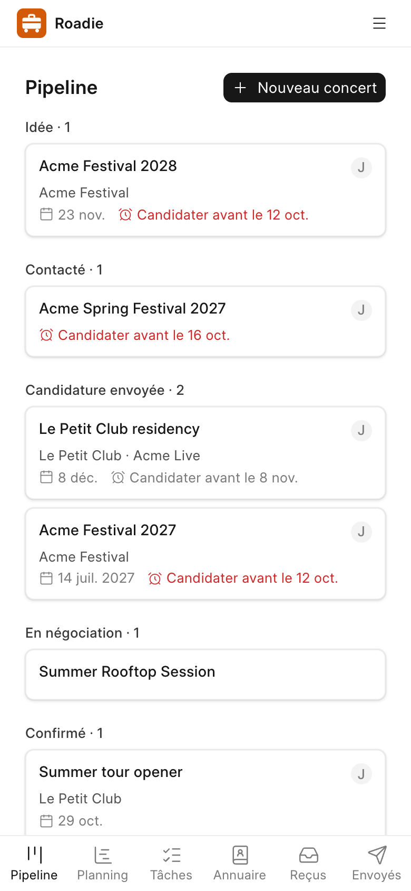

# Roadie

Track the people, places and deadlines that get the band booked.

Roadie is a small, shared booking desk for a band. Everyone in the band sees the same gigs, festivals, venues, promoters, tasks and email, and nobody has to learn an ERP to use it. It is a [Frappe](https://frappeframework.com) app with its own screen at `/roadie`, in English and French.



## What it does

- Pipeline: every gig on a kanban, from Idea to Played (or Declined / Dropped). Drag a card to change its status, with Undo. Application deadlines turn red when they get close.
- Gig panel: the gig's fields, a task checklist, attachments (riders, contracts), the email thread with a composer, and a comment thread for the band only.
- Planning: a gantt with one lane per gig showing the application window, the gig date and its tasks, plus a lane for loose tasks.
- My tasks: what is assigned to you, overdue first, ticked off in one click.
- Directory: festivals, venues, promoters and bands with their contacts, each in a list the band can filter, sort and pick the columns of.
- Inbox and Outbox: the band's shared mailbox, with read/unread and delivery status. Email to a contact also shows on the festival, venue, promoter or band they belong to.
- Reminders: the gig owner gets an email 7 days before an application closes, and the assignee gets one when a task is due.

On a phone the kanban and gantt become lists and the sidebar becomes a tab bar.

| Gig panel | Planning |
| --- | --- |
|  |  |

| Directory | Inbox | Phone |
| --- | --- | --- |
|  |  |  |

## Install

Roadie needs a [bench](https://github.com/frappe/bench) running Frappe v16.

```bash
bench get-app https://github.com/maasanto/roadie --branch develop
bench --site <your-site> install-app roadie
```

Give Roadie a site of its own. Band Members can read and edit every Contact and every email on the site, so install it next to ERPNext or another team's mailbox and they see those too.

Then, on the site:

1. Give the first bandmate a user with the Band Member role. Any member then invites the others from Settings, and each invitee joins as a Band Member. Members land on `/roadie` when they log in and never need the Desk.
2. Add the band's mailbox as an Email Account with incoming and outgoing enabled, and tick "Always use this email address as sender address". Roadie reads and sends through it, and without that box email goes out from the member's own address, so replies miss the shared Inbox. [Plugging in the band's mailbox](docs/email-account.md) walks through every setting, with OVH as the example.
3. Drive comes from [Frappe Suite](https://github.com/frappe/suite), which members reach with the Suite User role; Roadie offers its link picker in the email composer to whoever holds it. Optionally, point the sidebar's Drive link at the band's shared folder:

   ```bash
   bench --site <your-site> set-config band_drive_url "/drive"
   ```

## Development

The screen is a [frappe-ui](https://github.com/frappe/frappe-ui) app in `frontend/`. `bench build --app roadie` builds it, and `yarn dev` in `frontend/` serves it with hot reload.

```bash
bench --site <your-site> run-tests --app roadie
yarn --cwd apps/roadie/frontend test
```

The app uses `pre-commit` (ruff, eslint, prettier, pyupgrade): run `pre-commit install` in `apps/roadie`.

## License

[AGPL-3.0](license.txt). The email composer and the directory lists' filter, sort and quick filter controls are adapted from [Frappe CRM](https://github.com/frappe/crm), which is AGPL-3.0.
